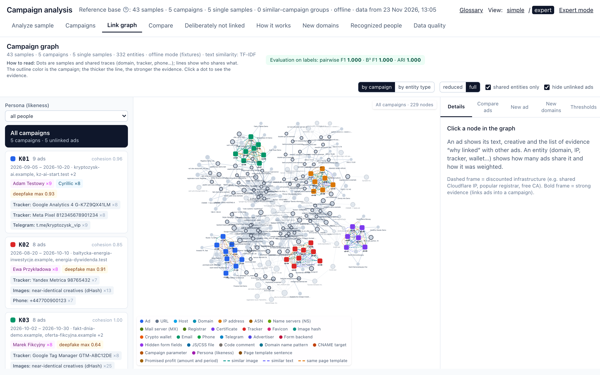
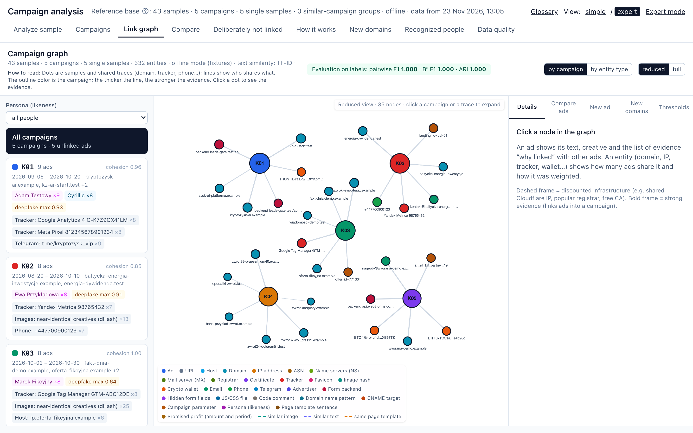
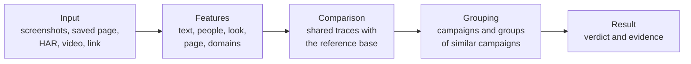
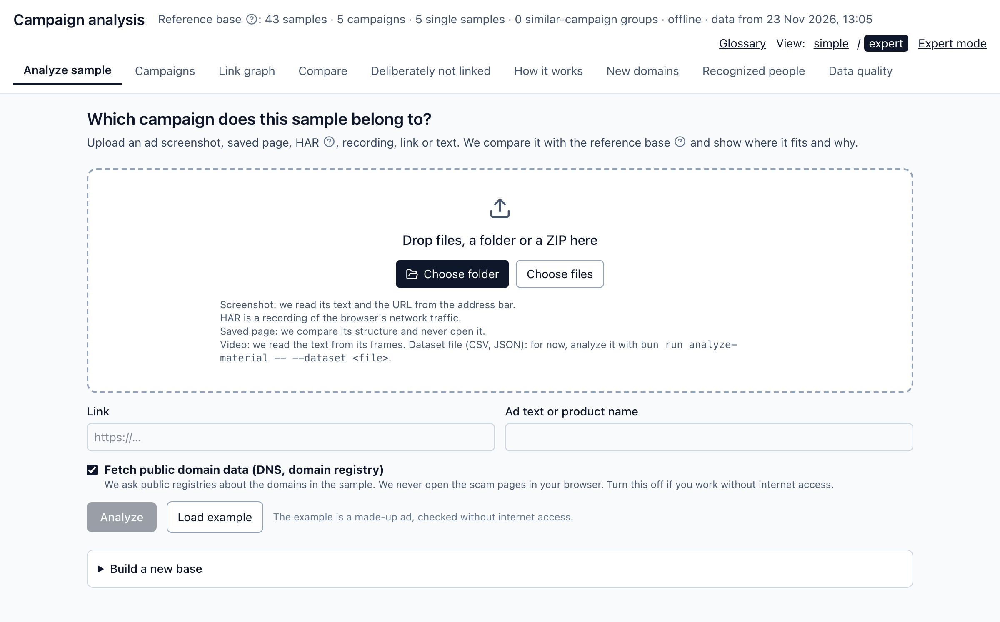
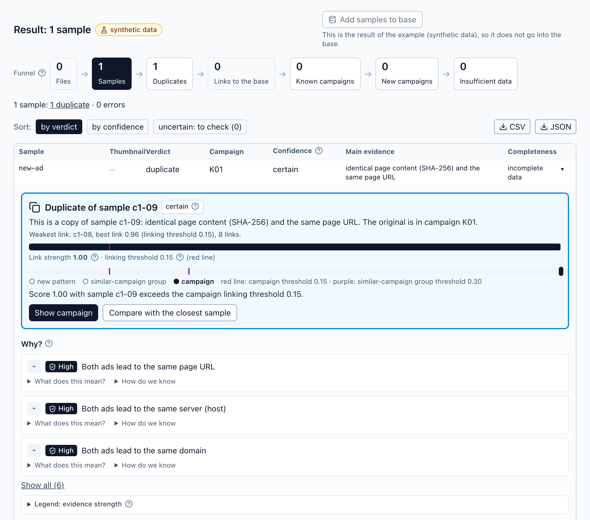
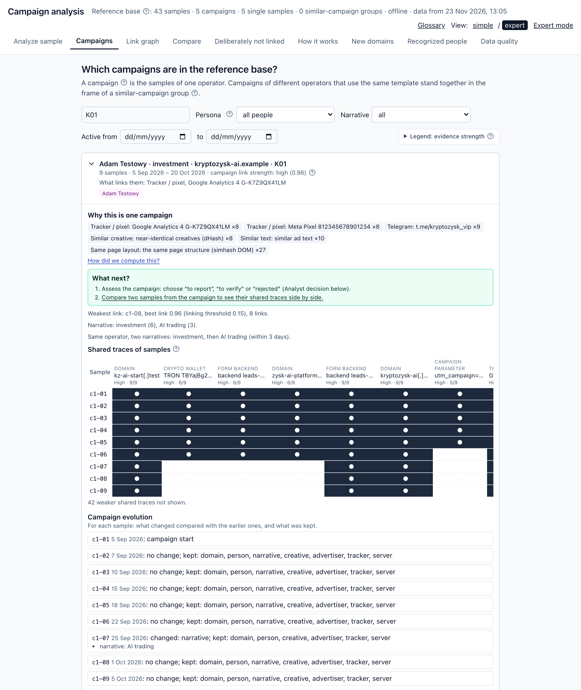
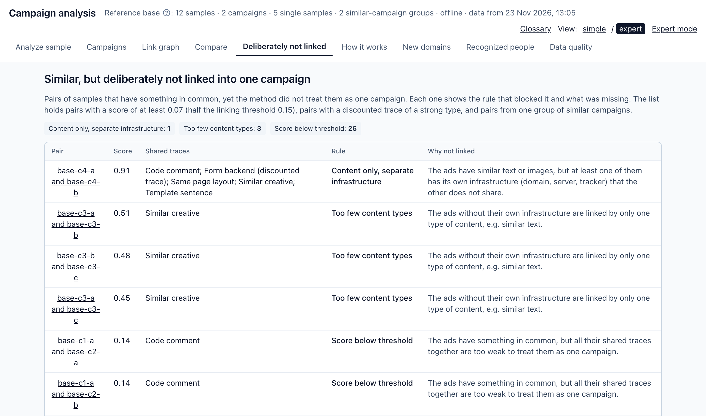

# Campaign Fingerprint

*Linking scam ads into campaigns. Polish name: Odcisk kampanii.*

Campaign Fingerprint takes single reports of scam ads (screenshots, saved pages, HAR files, recordings, links), groups them into campaigns run by the same operator and shows the evidence behind every link.

Built solo in 24 hours at HackNation 2026 (21–22 Nov 2026, Poland) for NASK's *Kolekcjoner fejków* (Fake Collector) challenge.

[Wersja polska](README.pl.md)



## The problem

Fraudulent ads that use the faces of well-known people are a daily sight on Polish social media. Many of them sell an investment scam, and some are deepfake ads with a generated face and voice.

Rafał Brzoska, founder of the parcel company InPost, is one of the best-known targets. In March 2024 a deepfake video with his face and voice promoted a fake investment on Facebook ([Spider's Web](https://spidersweb.pl/2024/03/inpost-rafal-brzoska-oszustwo-deepfake.html)). In August 2024 Poland's data protection authority ordered Meta to stop showing ads with his data in Poland for three months ([UODO](https://uodo.gov.pl/en/553/1826)). In October 2025 a new fake ad with his face appeared despite a court injunction ([Spider's Web](https://spidersweb.pl/2025/10/facebook-falszywe-reklamy-brzoska-krytyka.html)).

The person whose face is used is the first victim. The second is the person who trusts that face:

- More than half of victims hand over their details within the first hour ([CERT Polska](https://cert.pl/posts/2024/11/Oszustwa-reklamowe-na-duzych-platformach/)).
- One case in the 2025 summary of Poland's Central Cybercrime Bureau (CBZC) involved about 75 million zł taken from more than 1,500 people, roughly 50,000 zł per person ([CBZC](https://cbzc.policja.gov.pl/bzc/aktualnosci/785,Cyberprzestepczosc-w-2025-roku-efekty-procesowe-i-najwazniejsze-sprawy.html)).
- In 2025 the cases handled by the CBZC, across all kinds of online fraud, covered 537 million zł in losses. Less than 25 million zł, under 5%, was recovered ([Rzeczpospolita](https://www.rp.pl/media/art44117811-fbi-i-cert-polska-alarmuja-internetowi-oszusci-kradna-coraz-wiecej)).
- CERT Polska put 98,663 fake investment domains on its warning list in 2025, up from 2,443 in 2022 ([CERT Polska 2025 report, table 12](https://cert.pl/uploads/docs/Raport_CP_2025.pdf); [2023 report, table 5](https://cert.pl/uploads/docs/Raport_CP_2023.pdf)).

Takedowns happen one ad at a time. Of 122 scam ads that CERT Polska reported to Meta in 2024, 106 (86.8%) stayed online ([CERT Polska](https://cert.pl/posts/2024/11/Oszustwa-reklamowe-na-duzych-platformach/)). Of 46,511 reports that NASK sent to platforms in 2025, 12% led to removal ([NASK](https://www.nask.pl/media/2026/03/reakcja-platform-spolecznosciowych-na-zgloszenia-w-2025-roku.pdf)). A removed ad tends to come back on a new domain, and each report is handled as a separate case, although many of them come from the same operator. Bitdefender traced 310 coordinated scam campaigns on Meta in 25 countries back to two or three operator groups through shared UTM and pixel signatures and shared infrastructure; Poland was the most frequent target ([Bitdefender](https://www.bitdefender.com/en-us/blog/labs/global-investment-scam-network-using-meta-ads)).

## The solution

Campaign Fingerprint links single reports into campaigns by the traces an operator leaves behind: the page-builder account, tracker and pixel IDs, the click server behind a tracking link, domains and their registration, the image fingerprint of the creative, the page template, the backend that receives the phishing form, contact details and more. Scammers swap faces and domains every few days. Accounts and click servers cost them more to replace, so they last longer. This is campaign attribution built on OSINT traces, for CERT teams, trust and safety analysts and anyone who follows malvertising or does threat intelligence on fraud. It complements fraud detection that scores single ads: a classifier can say that an ad is suspicious, and Campaign Fingerprint says which other ads belong with it.

The result has two levels:

- **Campaign**: samples run by one operator. They are linked by strong evidence, such as a shared page-builder account or tracker ID, or by several independent pieces of evidence.
- **Group of similar campaigns**: campaigns of different operators that use the same ready-made kit (page template, narrative or persona). Page kits are sold and reused, so a shared kit on its own never makes a campaign.

Every link comes with its evidence in plain words and a strength level. Pairs that look alike but were deliberately not linked are listed with the rule that kept them apart. A new sample is compared with the reference base and gets one verdict: **known campaign**, **similar campaigns**, **new campaign**, **duplicate** or **insufficient data** (with a list of what to add).

For any campaign the app can build an evidence pack: facts kept apart from model output, a domain list for CERT, notices under Article 16 of the EU Digital Services Act, STIX 2.1 and SHA-256 checksums. Nothing is sent automatically; a person decides what to report. A scan scheduler (`bun run watch`) polls public sources such as Certificate Transparency logs, ad libraries, urlscan.io and the CERT Polska warning list for new domains and checks each one against the known campaigns.

The analysis runs offline in Docker, with no API keys and no outgoing requests unless you switch them on.



## How it works



1. **Input.** Load the files of a sample (screenshots, a saved page, a HAR file, a video) or just a link or the ad text. A phone screenshot with a visible address bar gives the domain through OCR.
2. **Features.** Extract traces in five families: text and people, appearance, page, infrastructure, platform and identifiers.
3. **Comparison.** Find traces shared with the reference base and weigh each one. Every trace type has a hand-set weight, from 1.0 (tracker, wallet) down to 0.05 (registrar, ASN). Shared infrastructure such as CDNs, free certificates and page-builder platforms gets a discount, and a trace that many samples share counts less (IDF). The evidence for a pair is combined with noisy-OR, `1 − Π(1 − wᵢ)`, into a link strength between 0 and 1.
4. **Grouping.** Apply explicit rules:
   - Strong evidence, such as the same page-builder account, links on its own (union-find).
   - Weaker evidence has to reach the linking threshold together (0.15 by default). A page template or a persona alone needs a second kind of trace.
   - A campaign built on content alone (similar text or image, no shared infrastructure) needs at least two kinds of content and is marked as the weaker case.
   - Different accounts on the same page-builder platform are never linked without strong evidence.
   - Discounted traces do not count.
   - The remaining links between campaigns form groups of similar campaigns (Louvain).
5. **Result.** Show where the sample landed and why.

Each piece of evidence has one of five strength levels:

| Level | Meaning |
|---|---|
| High | links on its own |
| Medium | counts together with other evidence |
| Needs corroboration | needs a second kind of trace |
| Discounted | shared by many unrelated sites, does not count |
| Description, not evidence | helps to filter, never links |

Faces and voices are compared only with a closed list of public figures. A match reads "face similar to X" and counts only towards groups of similar campaigns, because one famous face serves many operators. The `confidence` and `score` fields in the output describe the strength of the evidence; they are not probabilities. The weights are set by hand: there are too few labelled campaigns to learn them, and a model trained on the author's labels would learn the author's own rules. The full method, with every weight and rule: [docs/METODYKA.md](docs/METODYKA.md).

Stack: TypeScript, Next.js 16 and bun; graphology (Louvain) and Cytoscape.js for the graph; tesseract, ffmpeg, Chromaprint and OpenCV face models for media; an optional local LLM (Ollama) for summaries and name extraction, which the linking rules do not depend on.

## A tour of the app

The screenshots use synthetic data from the repository (fictional people, `.example` domains).

**Analyze sample.** Drop files, a folder or a ZIP, or paste a link or ad text. Before the run the app shows how it will split the upload into cases, and you can change the split.



**Result with evidence.** Each sample gets a verdict and a confidence level. Under "Why?" the evidence is listed strongest first, followed by the click route and what data is missing.



**Campaign card.** "Why this is one campaign" lists the traces the samples share. The matrix of shared traces shows which trace connects which sample, and the campaign evolution shows what changed from one sample to the next (for example the domain) and what was kept.



**Deliberately not linked.** Pairs that look alike but were kept apart, each with the rule that blocked the link, for example "Page kit only" or "Different platform accounts".



Other tabs: Link graph, Compare, How it works, New domains, Recognized people and Data quality ([docs/GUI.md](docs/GUI.md)).

## Results

All numbers below come from one offline run on 22 Nov 2026, on commit `5483d20`. Its linking code is the same as in the version submitted to the jury (tag `hacknation-2026`). Two data sets were used:

- **25 cases from the challenge organiser** (28 records). They are private and are not in this repository, so these numbers cannot be reproduced from the public code alone.
- **212 public scam pages** from outside the organiser's sample: mostly public urlscan.io scans, plus two Wayback Machine copies and one press article. Labels: 78 variants of four known campaigns and 134 negatives (105 pages of other operators with the same narrative or person, 29 pages from other accounts on the same page-builder platform).

The author assigned all labels, partly from the same traces the tool uses.

| What was measured | Result |
|---|---|
| Pages of other operators kept out of known campaigns | **134 / 134** |
| Variants assigned to the right known campaign | 34 / 78 |
| Variants marked "similar campaigns" with the right campaign | 13 / 78 |
| Variants assigned to a wrong campaign | 0 / 78 |
| Pair precision / recall on the 212 pages | 0.997 / 0.272 |
| Leave-one-out on the 25 cases (each case analysed against a base without it) | 23 / 25 correct, 0 in a wrong campaign |
| Scripted edits of real cases (new domain, JPEG, crop, strongest trace removed) | 137 variants, 0 false merges |
| Cases with files removed (no HAR, screenshots only, no page…) | 111 variants, 0 false merges |
| Analysis time for the 212 pages | about 1.3 s |

The most telling number is 134/134: no page of an unrelated operator was merged into a known campaign. The other variants got "new campaign", mostly because public scans lack the traces carried by the ad link, such as the click ID. The tool would rather leave a link out than make a wrong one. On the 25 cases, pair F1 against the author's labels is 0.897 (B-cubed F1 0.967). The thresholds were tuned on the same cases, so this measures agreement with the author's reading of them and says little about new data. On the synthetic sample in this repository precision and recall are 1.0 by construction.

Per-number commits, weight sensitivity and the hard-negative tests are in [docs/METODYKA.md](docs/METODYKA.md), section 12. To score the tool on your own labels: `bun run evaluate -- --csv result.csv --labels labels.json`.

## Quick start

The quick start uses the synthetic data shipped with the repository. You need Docker with Compose v2, and internet access for the first build.

```bash
git clone https://github.com/mirooon/campaign-fingerprint.git && cd campaign-fingerprint
mkdir -p dane                                          # folder shared with the container as /dane
docker compose build app                               # first build: 3–5 minutes
docker compose run --rm app bun run demo               # synthetic base (12 cases) and 8 samples to assess
VIEWER_DATA_DIR=/dane/demo/baza docker compose up -d   # app on http://localhost:3000
```

`demo` prints eight samples with the verdicts `known_campaign`, `similar_campaigns`, `duplicate`, `insufficient` and `new_campaign`. Among them are a dead page known only from a screenshot with the address bar, and three pages of one new campaign with changed domains and people. The results go to `./dane/demo/wynik/` (`wynik.json`, `wynik.csv`). Another port: `PORT=3001 VIEWER_DATA_DIR=/dane/demo/baza docker compose up -d`. Stop: `docker compose down`. Some folder and file names are Polish: `dane` means data, `baza` base, `wynik` result.

Your own samples against the demo base, one subfolder per case:

```bash
docker compose run --rm app bun run analyze-material -- --cases /dane/new --data /dane/demo/baza --csv /dane/result.csv
```

The CSV has one row per sample with the verdict, the campaign and the top piece of evidence. `bun run analyze-material -- --help` lists all options.

Without Docker you need bun 1.4 or newer (and Node 20 or newer for Next.js):

```bash
bun install
bun run demo                                  # writes dane/demo/baza and dane/demo/wynik
VIEWER_DATA_DIR=dane/demo/baza bun run dev    # app on http://localhost:3000
bun run test && bun run lint && bun run typecheck
```

OCR (tesseract with Polish), ffmpeg, the face and voice models and a local LLM are optional. Without them the matching step is reported as `skipped`, with the reason. How to install each one: [docs/JURY.md](docs/JURY.md#bez-dockera) (Polish).

## Documentation

| Document | What it covers |
|---|---|
| [docs/METODYKA.md](docs/METODYKA.md) | Method: traces, weights, linking rules, validation, limits |
| [docs/GUI.md](docs/GUI.md) | Interface: tabs, buttons, how to run an analysis |
| [docs/CECHY.md](docs/CECHY.md) | Catalogue of traces and features |
| [docs/WZORCE-KAMPANII.md](docs/WZORCE-KAMPANII.md) | How scam ad campaigns are built and which parts point to the operator (Polish) |
| [docs/ZRODLA-METADANYCH.md](docs/ZRODLA-METADANYCH.md) | Metadata sources and how many links each one gave (Polish) |
| [docs/TECHNICAL.md](docs/TECHNICAL.md) | Formats, weights, CLI, configuration, modules (Polish) |
| [docs/INTEGRACJA.md](docs/INTEGRACJA.md) | Versioned input and output contract with JSON schemas (Polish) |
| [docs/ZGODNOSC.md](docs/ZGODNOSC.md) | AI Act, GDPR and DSA notes (Polish) |
| [docs/DANE-NIEPUBLICZNE.md](docs/DANE-NIEPUBLICZNE.md) | The non-public data pack used for the measurements (Polish) |
| [docs/JURY.md](docs/JURY.md) | Run instructions for the HackNation 2026 jury (Polish) |

## Data and privacy

- The repository contains no data from the challenge organiser. The sample data and test fixtures are synthetic, generated by `scripts/gen-sample.ts`: fictional people, `.example` and `.test` domains, IP addresses from documentation ranges.
- Photos of public figures used for face matching come from Wikimedia Commons. The source, author and licence of each photo are in [data/faces/ZRODLA.md](data/faces/ZRODLA.md). A match is a hint for a person to review, never an identification.
- Samples are processed locally. Outgoing requests (DNS, RDAP, archived copies, ad libraries) are passive lookups that you switch on with CLI flags such as `--live`, `--lookups` and `--archive`, or with the "Fetch public domain data" checkbox in the browser. The Docker image sets `ANALYZE_OFFLINE=1`, which blocks them. The tool does not render pages or run their JavaScript, and it shows URLs defanged (`hxxps://example[.]test`).
- The version submitted to the HackNation jury is the tag [`hacknation-2026`](https://github.com/mirooon/campaign-fingerprint/tree/hacknation-2026) (Polish interface). Its run instructions are in [docs/JURY.md](docs/JURY.md) (Polish).

## Limitations

- The labels are the author's own, and the thresholds were tuned on the same 25 cases. There is no public Polish data set with campaign labels to compare against.
- The tool is cautious. On public scans it found about a quarter of the true links (pair recall 0.272), mostly because the scans lack the page code or the traces carried by the ad link.
- A cropped screenshot with no page is the weakest input. In scripted tests 7 of 21 such variants got "new campaign" without a note that data was missing.
- Text patterns and word lists target Polish-language scams, and OCR is set up for Polish. Ads in other languages still get infrastructure traces, but fewer text features.
- Pages are read statically. Content that appears only after JavaScript runs is invisible.
- Samples are compared in pairs, O(n²). Tens of thousands of samples would need an index.
- Face, voice, speech-to-text and CLIP matching run from the command line only. The tool does not detect deepfakes and does not judge whether a single ad is a scam.
- It was built in 24 hours, so expect rough edges.

## License

Code: MIT ([LICENSE](LICENSE)). Licences of all libraries, models, tools and services, with a check for non-commercial components: [LICENCJE.md](LICENCJE.md) (Polish).

## Author

Michał Mirończuk ([github.com/mirooon](https://github.com/mirooon)).

The OSINT and graph scaffolding was prepared before the event (18–20 Nov 2026). What existed before the event and what was built during it: [docs/POCHODZENIE-KODU.md](docs/POCHODZENIE-KODU.md) (Polish).
