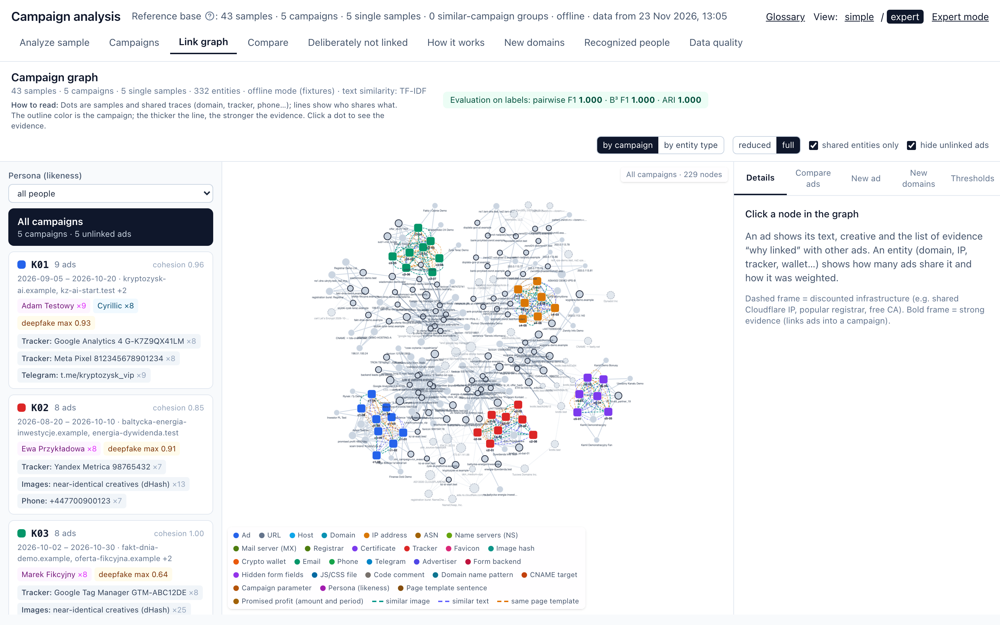
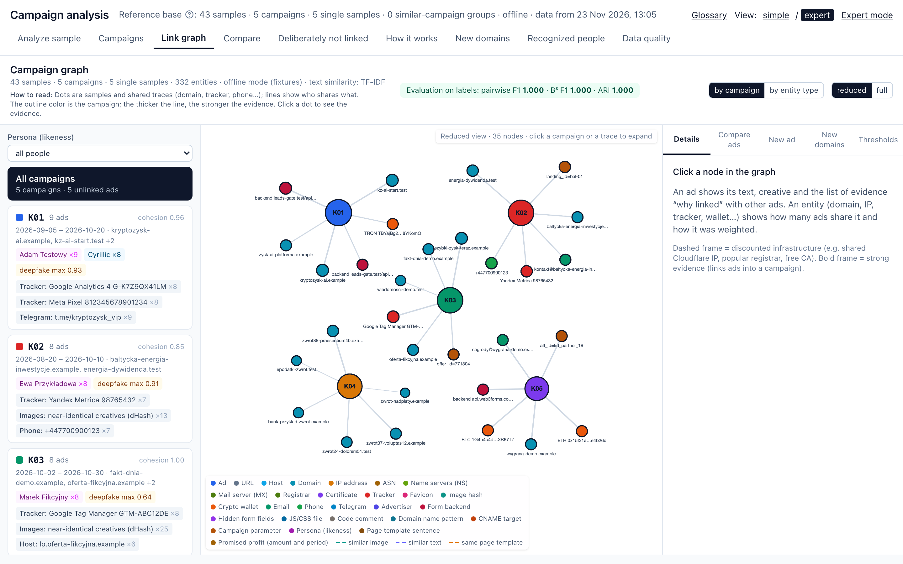
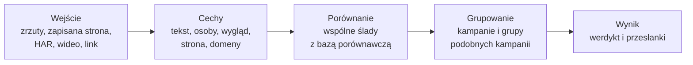
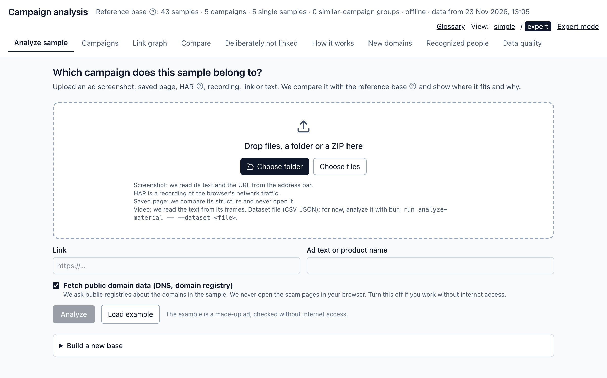
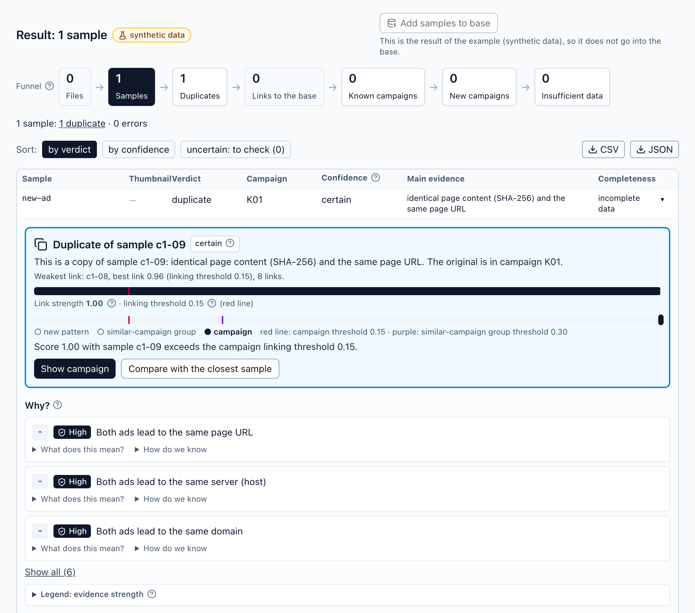
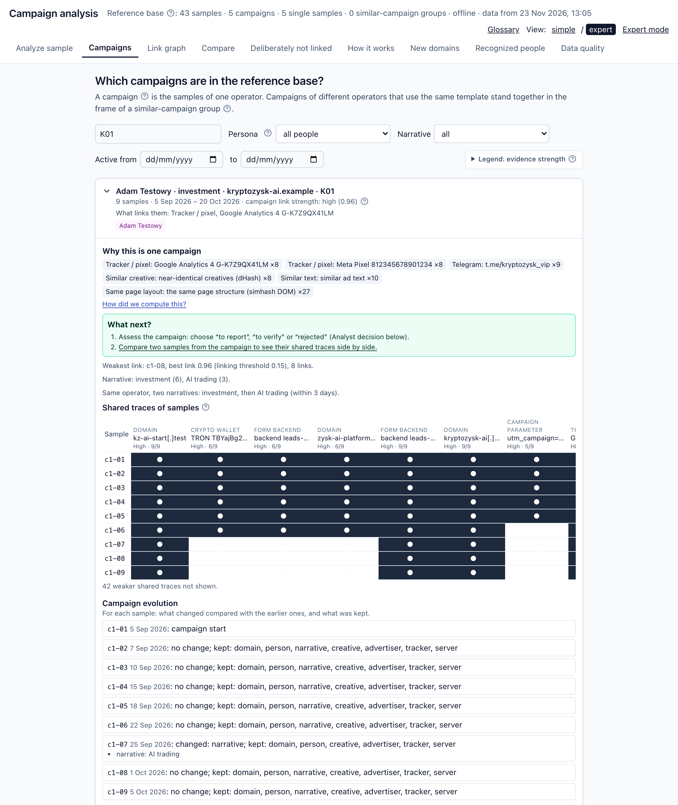
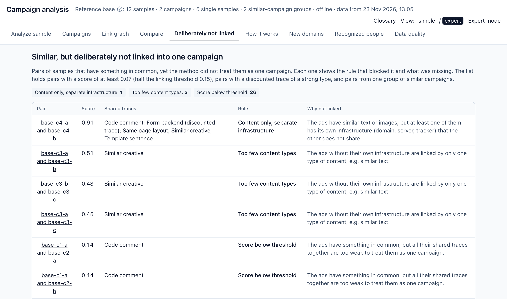

# Odcisk kampanii

*Łączenie oszukańczych reklam w kampanie*

Odcisk kampanii bierze pojedyncze zgłoszenia oszukańczych reklam (zrzuty ekranu, zapisane strony, pliki HAR, nagrania, linki), łączy je w kampanie jednego operatora i przy każdym połączeniu pokazuje przesłanki.

Projekt zbudowany w pojedynkę w 48 godzin na HackNation 2026 (21–22.11.2026, Polska) w odpowiedzi na zadanie NASK *Kolekcjoner fejków*.

[English version](README.md) · Instrukcja dla jury HackNation 2026 (stan z 22.11.2026): [docs/JURY.md](docs/JURY.md)



## Problem

Oszukańcze reklamy z twarzami znanych osób to codzienny widok w polskich mediach społecznościowych. Wiele z nich sprzedaje fałszywe inwestycje, a część to reklamy z deepfake'iem, czyli wygenerowaną twarzą i głosem.

Rafał Brzoska, założyciel InPostu, jest jednym z najbardziej znanych przykładów. W marcu 2024 r. na Facebooku krążył deepfake z jego twarzą i głosem, reklamujący fałszywą inwestycję ([Spider's Web](https://spidersweb.pl/2024/03/inpost-rafal-brzoska-oszustwo-deepfake.html)). W sierpniu 2024 r. Prezes UODO zakazał Mecie na trzy miesiące wyświetlania w Polsce reklam z jego danymi ([UODO](https://uodo.gov.pl/en/553/1826)). W październiku 2025 r., mimo zabezpieczenia sądowego, pojawiła się kolejna fałszywa reklama z jego twarzą ([Spider's Web](https://spidersweb.pl/2025/10/facebook-falszywe-reklamy-brzoska-krytyka.html)).

Osoba, której twarz wykorzystano, to pierwsza ofiara. Druga to człowiek, który tej twarzy zaufał:

- Ponad połowa ofiar podaje swoje dane w ciągu pierwszej godziny ([CERT Polska](https://cert.pl/posts/2024/11/Oszustwa-reklamowe-na-duzych-platformach/)).
- Jedna ze spraw z podsumowania 2025 r. Centralnego Biura Zwalczania Cyberprzestępczości (CBZC) dotyczyła ok. 75 mln zł wyłudzonych od ponad 1500 osób, czyli średnio ok. 50 tys. zł na osobę ([CBZC](https://cbzc.policja.gov.pl/bzc/aktualnosci/785,Cyberprzestepczosc-w-2025-roku-efekty-procesowe-i-najwazniejsze-sprawy.html)).
- W 2025 r. straty w sprawach prowadzonych przez CBZC, obejmujących wszystkie rodzaje oszustw internetowych, wyniosły 537 mln zł. Odzyskano mniej niż 25 mln zł, czyli poniżej 5% ([Rzeczpospolita](https://www.rp.pl/media/art44117811-fbi-i-cert-polska-alarmuja-internetowi-oszusci-kradna-coraz-wiecej)).
- CERT Polska wpisał w 2025 r. na listę ostrzeżeń 98 663 domeny fałszywych inwestycji, wobec 2443 w 2022 r. ([raport CERT Polska za 2025, tab. 12](https://cert.pl/uploads/docs/Raport_CP_2025.pdf); [raport za 2023, tab. 5](https://cert.pl/uploads/docs/Raport_CP_2023.pdf)).

Reklamy zdejmuje się pojedynczo. Ze 122 oszukańczych reklam, które CERT Polska zgłosił Mecie w 2024 r., 106 (86,8%) pozostało w sieci ([CERT Polska](https://cert.pl/posts/2024/11/Oszustwa-reklamowe-na-duzych-platformach/)). Z 46 511 zgłoszeń, które NASK wysłał do platform w 2025 r., 12% zakończyło się usunięciem treści ([NASK](https://www.nask.pl/media/2026/03/reakcja-platform-spolecznosciowych-na-zgloszenia-w-2025-roku.pdf)). Zdjęta reklama zwykle wraca pod nową domeną, a każde zgłoszenie jest rozpatrywane jako osobna sprawa, choć za wieloma z nich stoi ten sam operator. Bitdefender powiązał 310 skoordynowanych kampanii oszustw na Mecie w 25 krajach z dwiema lub trzema grupami operatorów, po wspólnych sygnaturach UTM i pikseli oraz po wspólnej infrastrukturze; Polska była najczęstszym celem ([Bitdefender](https://www.bitdefender.com/en-us/blog/labs/global-investment-scam-network-using-meta-ads)).

## Rozwiązanie

Odcisk kampanii łączy pojedyncze zgłoszenia w kampanie po śladach, które zostawia operator: konto na platformie stron, identyfikatory trackerów i pikseli, serwer kliknięć za linkiem śledzącym, domeny i ich rejestracja, odcisk obrazu kreacji, szablon strony, backend formularza wyłudzającego dane, dane kontaktowe i inne. Oszuści zmieniają twarze i domeny co kilka dni. Konto i serwer kliknięć kosztują ich więcej, więc zostają dłużej. To przypisywanie reklam do kampanii na podstawie śladów OSINT, dla zespołów CERT, analityków trust and safety i każdego, kto śledzi malvertising albo zajmuje się threat intelligence w obszarze oszustw. Uzupełnia wykrywanie oszustw, które ocenia pojedyncze reklamy: klasyfikator powie, że reklama jest podejrzana, a Odcisk kampanii powie, które inne reklamy do niej należą.

Wynik ma dwa poziomy:

- **Kampania**: materiały jednego operatora. Łączy je silny dowód, np. wspólne konto na platformie stron albo identyfikator trackera, albo kilka niezależnych przesłanek.
- **Grupa podobnych kampanii**: kampanie różnych operatorów, które korzystają z tego samego gotowego zestawu (szablon strony, narracja albo persona). Zestawy stron są sprzedawane i używane wielokrotnie, więc sam wspólny zestaw nigdy nie tworzy kampanii.

Każde połączenie ma przesłanki opisane zwykłymi słowami i poziom siły. Pary, które wyglądają podobnie, ale celowo nie zostały połączone, są wypisane razem z regułą, która je rozdzieliła. Nowy materiał jest porównywany z bazą porównawczą i dostaje jeden werdykt: **znana kampania**, **podobne kampanie**, **nowa kampania**, **duplikat** albo **za mało danych** (z listą tego, co dorzucić).

Dla każdej kampanii aplikacja może zbudować paczkę dowodów: fakty oddzielone od wyników modeli, listę domen dla CERT, zgłoszenia z art. 16 DSA, STIX 2.1 i sumy SHA-256. Narzędzie niczego nie wysyła samo; o zgłoszeniu decyduje człowiek. Harmonogram skanów (`bun run watch`) odpytuje publiczne źródła, np. logi Certificate Transparency, biblioteki reklam, urlscan.io i Listę Ostrzeżeń CERT Polska, o nowe domeny i sprawdza każdą z nich względem znanych kampanii.

Analiza działa offline w Dockerze, bez kluczy API i bez zapytań wychodzących, chyba że je włączysz.



## Jak to działa



1. **Wejście.** Wczytujesz pliki materiału (zrzuty, zapisaną stronę, plik HAR, wideo) albo sam link lub tekst reklamy. Zrzut z telefonu z widocznym paskiem adresu daje domenę przez OCR.
2. **Cechy.** Narzędzie wyciąga ślady w pięciu rodzinach: tekst i osoby, wygląd, strona, infrastruktura, platforma i identyfikatory.
3. **Porównanie.** Szuka śladów wspólnych z bazą porównawczą i waży każdy z nich. Każdy rodzaj śladu ma wagę ustawioną ręcznie, od 1,0 (tracker, portfel) do 0,05 (rejestrator, ASN). Infrastruktura wspólna dla wielu stron, np. sieci CDN, darmowe certyfikaty i platformy stron, dostaje zniżkę, a ślad, który ma wiele materiałów, liczy się słabiej (IDF). Przesłanki jednej pary łączy wzór noisy-OR, `1 − Π(1 − wᵢ)`, w siłę powiązania od 0 do 1.
4. **Grupowanie.** Narzędzie stosuje jawne reguły:
   - Silny dowód, np. to samo konto na platformie stron, łączy samodzielnie (union-find).
   - Słabsze przesłanki muszą razem przekroczyć próg łączenia (domyślnie 0,15). Sam szablon strony albo sama persona wymaga drugiego rodzaju śladu.
   - Kampania oparta wyłącznie na treści (podobny tekst lub obraz, bez wspólnej infrastruktury) wymaga co najmniej dwóch rodzajów treści i jest oznaczana jako słabsza.
   - Różne konta na tej samej platformie stron nigdy nie trafiają do jednej kampanii bez silnego dowodu.
   - Pominięte ślady się nie liczą.
   - Pozostałe powiązania między kampaniami tworzą grupy podobnych kampanii (Louvain).
5. **Wynik.** Narzędzie pokazuje, gdzie trafił materiał i dlaczego.

Każda przesłanka ma jeden z pięciu poziomów siły (w nawiasach nazwy z interfejsu):

| Poziom | Znaczenie |
|---|---|
| Wysoka (High) | łączy samodzielnie |
| Średnia (Medium) | liczy się razem z innymi przesłankami |
| Wymaga potwierdzenia (Needs corroboration) | potrzebny drugi rodzaj śladu |
| Pominięta (Discounted) | wspólna dla wielu niezależnych stron, nie liczy się |
| Opis, nie dowód (Description, not evidence) | pomaga filtrować, nigdy nie łączy |

Twarze i głosy są porównywane tylko z zamkniętą listą osób publicznych. Dopasowanie brzmi „podobna twarz do X” i liczy się tylko do grup podobnych kampanii, bo jedna znana twarz służy wielu operatorom. Pola `confidence` i `score` w wyniku opisują siłę przesłanek; nie są prawdopodobieństwem. Wagi są ustawione ręcznie: oznaczonych kampanii jest za mało, żeby je wyuczyć, a model wytrenowany na etykietach autora nauczyłby się jego własnych reguł. Pełna metoda ze wszystkimi wagami i regułami: [docs/METODYKA.md](docs/METODYKA.md).

Technologie: TypeScript, Next.js 16 i bun; graphology (Louvain) i Cytoscape.js do grafu; tesseract, ffmpeg, Chromaprint i modele twarzy OpenCV do mediów; opcjonalny lokalny LLM (Ollama) do streszczeń i wyciągania nazwisk, od którego reguły łączenia nie zależą.

## Przegląd aplikacji

Interfejs aplikacji jest po angielsku. Zrzuty pokazują dane syntetyczne z repozytorium (fikcyjne osoby, domeny `.example`).

**Analyze sample (analiza materiału).** Upuść pliki, folder albo ZIP albo wklej link lub tekst reklamy. Przed analizą aplikacja pokazuje, jak podzieli wgrane pliki na sprawy, i pozwala ten podział zmienić.



**Wynik z przesłankami.** Każdy materiał dostaje werdykt i poziom pewności. Pod „Why?” („Dlaczego?”) są przesłanki od najsilniejszej, a dalej trasa kliknięcia i lista brakujących danych.



**Karta kampanii.** „Why this is one campaign” („Dlaczego to jedna kampania”) wymienia ślady wspólne dla materiałów. Macierz wspólnych śladów pokazuje, który ślad łączy który materiał, a ewolucja kampanii pokazuje, co zmieniło się między kolejnymi materiałami (np. domena), a co zostało.



**Deliberately not linked (celowo nie połączone).** Pary, które wyglądają podobnie, ale zostały rozdzielone, każda z regułą, która zablokowała połączenie, np. „Page kit only” (tylko zestaw stron) albo „Different platform accounts” (różne konta na platformie).



Pozostałe zakładki: Link graph, Compare, How it works, New domains, Recognized people i Data quality ([docs/GUI.md](docs/GUI.md)).

## Wyniki

Wszystkie liczby poniżej pochodzą z jednego przebiegu bez sieci, 22.11.2026, na commicie `a407767`. Kod łączenia jest w nim taki sam jak w wersji oddanej jury (tag `hacknation-2026`). Użyto dwóch zbiorów:

- **25 spraw od organizatora zadania** (28 rekordów). Są poufne i nie ma ich w repozytorium, więc tych liczb nie da się odtworzyć z samego publicznego kodu.
- **212 publicznych stron oszustw** spoza próbki organizatora: głównie publiczne skany urlscan.io, do tego dwie kopie z Wayback Machine i jeden artykuł prasowy. Etykiety: 78 wariantów czterech znanych kampanii i 134 negatywy (105 stron innych operatorów z tą samą narracją lub osobą, 29 stron z innych kont tej samej platformy stron).

Wszystkie etykiety nadał autor, częściowo po tych samych śladach, których używa narzędzie.

| Co mierzono | Wynik |
|---|---|
| Strony innych operatorów niesklejone ze znanymi kampaniami | **134 / 134** |
| Warianty przypisane do właściwej znanej kampanii | 34 / 78 |
| Warianty oznaczone jako „podobne kampanie” z właściwą kampanią | 13 / 78 |
| Warianty przypisane do złej kampanii | 0 / 78 |
| Precyzja / czułość par na 212 stronach | 0,997 / 0,272 |
| Leave-one-out na 25 sprawach (każda sprawa analizowana względem bazy bez niej) | 23 / 25 trafnie, 0 w złej kampanii |
| Zmiany prawdziwych spraw skryptem (nowa domena, JPEG, przycięcie, usunięty najsilniejszy ślad) | 137 wariantów, 0 fałszywych sklejeń |
| Sprawy z usuniętymi plikami (bez HAR, same zrzuty, bez strony…) | 111 wariantów, 0 fałszywych sklejeń |
| Czas analizy 212 stron | ok. 1,3 s |

Najwięcej mówi wynik 134/134: żadna strona niezwiązanego operatora nie została sklejona ze znaną kampanią. Pozostałe warianty dostały „nową kampanię”, głównie dlatego, że w publicznych skanach brakuje śladów z linku reklamy, np. identyfikatora kliknięcia. Narzędzie woli nie połączyć, niż połączyć błędnie. Na 25 sprawach F1 par względem etykiet autora wynosi 0,897 (F1 B-cubed 0,967). Progi dobierano na tych samych sprawach, więc to miara zgodności z tym, jak autor rozumie te sprawy, i niewiele mówi o nowych danych. Na próbce syntetycznej z repozytorium precyzja i czułość wynoszą 1,0 z założenia.

Commity przy każdej liczbie, wrażliwość wag i testy twardych negatywów: [docs/METODYKA.md](docs/METODYKA.md), punkt 12. Ocena na własnych etykietach: `bun run evaluate -- --csv result.csv --labels labels.json`.

## Szybki start

Szybki start działa na danych syntetycznych z repozytorium. Potrzebujesz Dockera z Compose v2 i internetu przy pierwszej budowie.

```bash
git clone https://github.com/mirooon/odcisk-kampanii.git && cd odcisk-kampanii
mkdir -p dane                                          # katalog wymiany plików z kontenerem (/dane)
docker compose build app                               # pierwsza budowa: 3–5 minut
docker compose run --rm app bun run demo               # baza syntetyczna (12 spraw) i 8 materiałów do oceny
VIEWER_DATA_DIR=/dane/demo/baza docker compose up -d   # aplikacja na http://localhost:3000
```

`demo` wypisuje osiem materiałów z werdyktami `known_campaign`, `similar_campaigns`, `duplicate`, `insufficient` i `new_campaign`. Wśród nich jest martwa strona, znana tylko ze zrzutu z paskiem adresu, i trzy strony jednej nowej kampanii ze zmienionymi domenami i osobami. Wynik trafia do `./dane/demo/wynik/` (`wynik.json`, `wynik.csv`). Inny port: `PORT=3001 VIEWER_DATA_DIR=/dane/demo/baza docker compose up -d`. Zatrzymanie: `docker compose down`.

Własne materiały względem bazy demo, jeden podkatalog na sprawę:

```bash
docker compose run --rm app bun run analyze-material -- --cases /dane/new --data /dane/demo/baza --csv /dane/result.csv
```

CSV ma wiersz na materiał z werdyktem, kampanią i najważniejszą przesłanką. `bun run analyze-material -- --help` wypisuje wszystkie opcje.

Bez Dockera potrzebujesz buna w wersji 1.4 lub nowszej (i Node 20 lub nowszego dla Next.js):

```bash
bun install
bun run demo                                  # zapisuje dane/demo/baza i dane/demo/wynik
VIEWER_DATA_DIR=dane/demo/baza bun run dev    # aplikacja na http://localhost:3000
bun run test && bun run lint && bun run typecheck
```

OCR (tesseract z językiem polskim), ffmpeg, modele twarzy i głosu oraz lokalny LLM są opcjonalne. Bez nich odpowiedni krok jest w wyniku oznaczony jako `skipped`, z powodem. Instalacja każdego z nich: [docs/JURY.md](docs/JURY.md#bez-dockera).

## Dokumentacja

| Dokument | Co opisuje |
|---|---|
| [docs/METODYKA.md](docs/METODYKA.md) | Metoda: ślady, wagi, reguły łączenia, walidacja, ograniczenia (po angielsku) |
| [docs/GUI.md](docs/GUI.md) | Interfejs: zakładki, przyciski, jak przeprowadzić analizę (po angielsku) |
| [docs/CECHY.md](docs/CECHY.md) | Katalog śladów i cech (po angielsku) |
| [docs/WZORCE-KAMPANII.md](docs/WZORCE-KAMPANII.md) | Jak zbudowane są kampanie oszukańczych reklam i co w nich wskazuje operatora |
| [docs/ZRODLA-METADANYCH.md](docs/ZRODLA-METADANYCH.md) | Źródła metadanych i ile powiązań dał każdy z nich |
| [docs/TECHNICAL.md](docs/TECHNICAL.md) | Formaty, wagi, CLI, konfiguracja, moduły |
| [docs/INTEGRACJA.md](docs/INTEGRACJA.md) | Wersjonowany kontrakt wejścia i wyjścia ze schematami JSON |
| [docs/ZGODNOSC.md](docs/ZGODNOSC.md) | AI Act, RODO i DSA |
| [docs/DANE-NIEPUBLICZNE.md](docs/DANE-NIEPUBLICZNE.md) | Niepubliczna paczka danych użyta w pomiarach |
| [docs/JURY.md](docs/JURY.md) | Instrukcja uruchomienia dla jury HackNation 2026 |

## Dane i prywatność

- Repozytorium nie zawiera danych organizatora zadania. Dane przykładowe i testowe są syntetyczne, wygenerowane skryptem `scripts/gen-sample.ts`: fikcyjne osoby, domeny `.example` i `.test`, adresy IP z pul dokumentacyjnych.
- Zdjęcia osób publicznych używane do porównywania twarzy pochodzą z Wikimedia Commons. Źródło, autor i licencja każdego zdjęcia są w [data/faces/ZRODLA.md](data/faces/ZRODLA.md). Dopasowanie to wskazówka do sprawdzenia przez człowieka, nigdy ustalenie tożsamości.
- Materiały są przetwarzane lokalnie. Zapytania wychodzące (DNS, RDAP, kopie archiwalne, biblioteki reklam) to pasywne zapytania, które włączasz flagami CLI, np. `--live`, `--lookups` i `--archive`, albo polem „Fetch public domain data” w przeglądarce. Obraz Dockera ustawia `ANALYZE_OFFLINE=1`, co je blokuje. Narzędzie nie renderuje stron, nie wykonuje ich JavaScriptu i pokazuje adresy w formie rozbrojonej (`hxxps://example[.]test`).
- Wersja oddana jury HackNation to tag [`hacknation-2026`](https://github.com/mirooon/odcisk-kampanii/tree/hacknation-2026) (polski interfejs). Instrukcja jej uruchomienia jest w [docs/JURY.md](docs/JURY.md).

## Ograniczenia

- Etykiety są autora, a progi dobierano na tych samych 25 sprawach. Nie ma publicznego polskiego zbioru z etykietami kampanii, z którym dałoby się je porównać.
- Narzędzie jest ostrożne. Na publicznych skanach znalazło ok. jednej czwartej prawdziwych powiązań (czułość par 0,272), głównie dlatego, że w skanach brakuje kodu strony albo śladów z linku reklamy.
- Przycięty zrzut bez strony to najsłabsze wejście. W testach skryptem 7 z 21 takich wariantów dostało „nową kampanię” bez informacji, że brakuje danych.
- Wzorce tekstu i listy słów są nastawione na polskojęzyczne oszustwa, a OCR jest ustawiony na język polski. Reklamy w innych językach nadal dają ślady infrastruktury, ale mniej cech tekstu.
- Strony są czytane statycznie. Treść, która pojawia się dopiero po wykonaniu JavaScriptu, jest niewidoczna.
- Materiały są porównywane parami, O(n²). Dziesiątki tysięcy materiałów wymagałyby indeksu.
- Porównywanie twarzy, głosu, transkrypcja mowy i CLIP działają tylko z wiersza poleceń. Narzędzie nie wykrywa deepfake'ów i nie ocenia, czy pojedyncza reklama jest oszustwem.
- Powstało w 48 godzin, więc ma niedoróbki.

## Licencja

Kod: MIT ([LICENSE](LICENSE)). Licencje wszystkich bibliotek, modeli, narzędzi i usług, z kontrolą składników niekomercyjnych: [LICENCJE.md](LICENCJE.md).

## Autor

Michał Mirończuk ([github.com/mirooon](https://github.com/mirooon)).

Szkielet narzędzi OSINT i grafowych powstał przed wydarzeniem (18–20.11.2026). Co istniało przed wydarzeniem, a co powstało w jego trakcie: [docs/POCHODZENIE-KODU.md](docs/POCHODZENIE-KODU.md).
